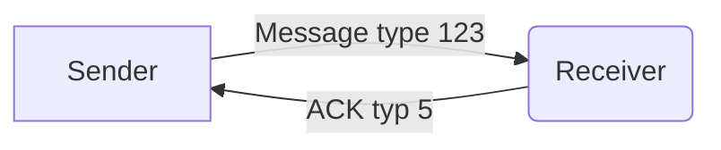
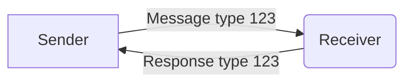
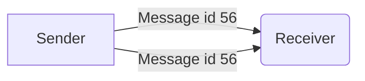

# 5: ACK

{{ messageData.description }}

## Response conventions

See [Responses and acknowledgments](../protocol/responses) for correlation, Status, typed replies and when an ACK is sent. In particular, omitting Message ID does not guarantee that no error ACK or typed response will be sent. This page defines the MT5 packet format.

<template v-if="hasHeader">

## Header

<HeaderSection :messageId="messageId" :yamlData="protocolData" />

</template>

<template v-if="hasPayload">

## Payload

<PayloadSection :messageId="messageId" :yamlData="protocolData" />

</template>

<template v-if="hasExamples">

## Examples

<ExamplesSection :messageId="messageId" :yamlData="protocolData" />

</template>

## Sequence

##### Simple ACK

The simple case is that a sender sends a message, and the receiver responds with an ACK message.

##### Response

An immediate typed response can replace a separate ACK. Its [Response to header](../protocol/headers#3-response-to) correlates it with the request when a nonzero Message ID was supplied.

In such cases the response will not have an ACK message type, instead it will have the message type of the response (often the same as the request).

##### Retries

If a sender does not receive an ACK or response, it may resend the message.

## Code

<CodeSection :messageId="messageId" :yamlData="protocolData" />
